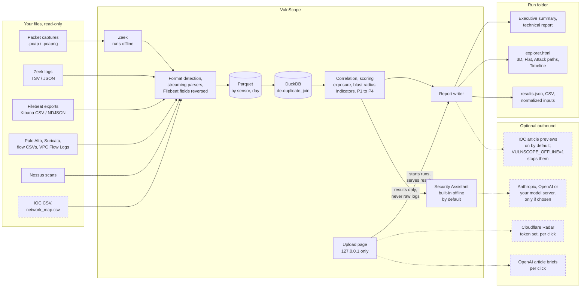

# Architecture and engineering decisions

This document explains the implementation responsibilities and tradeoffs of a local
telemetry-and-scan correlation proof of concept. It does not claim to meet a production-service
standard.

## Responsibilities



Solid arrows are the analysis path, which never contacts the hosts or addresses in your data.
Dashed arrows are the only outbound connections, each tied to a feature you turn on or click;
see [outbound network use](METHODS.md#privacy-and-outbound-network-use). In Docker, everything
inside the VulnScope box runs in the container: inputs are mounted read-only, the run folder is
`/runs`, and the page is published on `127.0.0.1` only.

The same path in text:

```text
Folder path, Browse, upload, or command line
  → format detection by content (PCAP → Zeek logs; Filebeat export → Zeek records)
  → streaming parsers, batches of records
  → Parquet partitioned by sensor and day, in a temporary working directory
  → DuckDB: sort, de-duplicate across sensors, join with scan findings
  → correlation: exposure, blast radius, indicators, score, coverage
  → reports: Markdown / HTML / CSV / JSON / SVG, Explorer HTML
  → optional Security Assistant, article previews and briefs, Radar lookups
```

| Module | Knowledge hidden behind its interface |
| --- | --- |
| `vulnflow/parsers/` | Format detection and per-source field rules: Zeek TSV/JSON, Palo Alto, Suricata, generic flows, Nessus, Filebeat ECS reversal |
| `vulnflow/pcap.py` | Finding Zeek, running it on a capture into a temporary folder, reporting unreadable captures |
| `vulnflow/normalize.py`, `schema.py` | Canonical `Flow`, `ThreatEvent`, `Finding` and Zeek/OT event records; IP, protocol and time normalization |
| `vulnflow/store.py` | Batched Parquet writing, cross-sensor de-duplication and DuckDB queries |
| `vulnflow/resources.py` | DuckDB memory, thread and spill sizing; one-job-at-a-time slot; limit-hit messages |
| `vulnflow/correlate.py` | Exposure, blast radius, indicator grading, scoring weights and coverage |
| `vulnflow/netmap.py` | Optional network map parsing and on-prem/cloud labeling |
| `vulnflow/ioc_archive.py`, `article_preview.py`, `article_brief.py` | IOC CSV matching, source previews, optional OpenAI article briefs |
| `vulnflow/report.py`, `diagram.py`, `visual.py`, `explore.py` | Report shape and wording, themes, the hostile activity diagram, Explorer data |
| `vulnflow/static/` | Explorer, 3D, Attack paths and Timeline views (three.js bundled) |
| `vulnflow/llm.py`, `offline_assistant.py` | Provider adapters, grounding, redaction, and the built-in offline assistant |
| `vulnflow/radar.py` | Optional Cloudflare Radar lookups for one selected indicator |
| `vulnflow/branding.py` | Analyst name prefix and logo, logo validation, password hash |
| `vulnflow/web/handler.py`, `routes.py`, `multipart.py` | Loopback HTTP server: Host/Origin/CSRF checks, security headers and streamed uploads in one request handler; a route table sends each path to the page module that serves it |
| `vulnflow/web/` page modules | `upload.py` (Analyze), `folders.py` (Browse and folder paths), `runs.py` (results pages, Security Assistant, briefs, Radar), `settings.py`, `branding_page.py`, `compare_page.py` |
| `vulnflow/compare.py` | Compare reports: counts per report and network from saved `results.json` files; looks for IOCs again in saved normalized data with the analysis' matcher |
| `vulnflow/combine.py` | All networks on one Explorer map: merges the compared reports' saved Explorer data, one island per report, with the shared IOCs and vulnerabilities highlighted |
| `vulnflow/errors.py` | `UserError`: a problem the person can fix, whose message is shown. Any other exception is a bug: the page says the step failed and the traceback goes to the server console |
| `vulnflow/pipeline.py`, `cli.py` | Orchestration and the `vulnflow` command line |
| `docker/`, `Dockerfile`, `compose.yaml` | Container image with Zeek, entry point and folder sharing |

## Large inputs and resource sizing

Inputs are streamed, not loaded into memory. Each parser yields records in batches; network
sessions are written to Parquet files partitioned by sensor and day in a temporary working
directory, then sorted, de-duplicated and correlated with DuckDB SQL. The working directory is
deleted when the run ends.

- `--workdir DIR` (or `VULNSCOPE_WORKDIR`) puts the temporary files on a disk with room for them;
  plan for roughly the size of the uncompressed session logs. The upload page uses its run folder.
- DuckDB gets 60% of the RAM (or of the container's cgroup memory limit, when lower), less if the
  machine is already busy, and never more than a ceiling that keeps 25% (at least 1.5 GiB) for the
  OS and the rest of the app. Threads follow the CPUs the process may use, one per GiB of DuckDB
  memory at most. Beyond its memory limit DuckDB spills to the working directory, capped at 80% of
  that disk's free space. Each run prints the values it chose.
- Overrides, all clamped to those ceilings: `VULNSCOPE_DUCKDB_MEMORY` (`8GB`, `6GiB`, or `50%` of
  usable RAM), `VULNSCOPE_DUCKDB_THREADS`, `VULNSCOPE_DUCKDB_MAX_TEMP` (`200GB` or `50%` of free
  disk). Roughly, de-duplication needs about 1 GB of DuckDB memory per GB of Zeek logs.
- One analysis runs at a time per process; the upload page refuses a second one before reading its
  upload. `VULNSCOPE_MAX_JOBS=N` allows N at once and splits the budget between them.

Measured results for 10 GB and 50 GB Zeek sets are in
[scripts/bench/RESULTS_DUCKDB.md](scripts/bench/RESULTS_DUCKDB.md).

Tradeoff: DuckDB is the one runtime dependency. It replaces in-memory Python de-duplication, which
needed about ten times the input size in RAM, with a bounded engine that can spill to disk.

## Docker container

The image is built on the official `zeek/zeek` base for linux/amd64 and linux/arm64. DuckDB is
installed in a throwaway build stage, so the final image has no package manager or pip and fetches
nothing at run time. Compose never pulls it from a registry (`pull_policy: never`).

| Mount | Inside the container | Access |
| --- | --- | --- |
| `VULNSCOPE_DATA` (default `./data`) | `/data` | read-only |
| Your home folder, or `VULNSCOPE_BROWSE` | same path on macOS/Linux; `/host` on Windows | read-only |
| `VULNSCOPE_RUNS` (default `./vulnscope-out`) | `/runs` (results, temporary files, settings, branding) | read-write |

Browse starts at the shared home folder; pasted Windows paths (`C:\Users\you\...`) are translated.
A browser can only upload a picked folder's contents, not tell the server its path, so in Docker
**Browse** locates the folder in the shared tree by its name, file names and modification times.
To share an evidence drive, set `VULNSCOPE_BROWSE` (`/Volumes/Evidence`, `/mnt/evidence`, or `D:\`
with `VULNSCOPE_BROWSE_AT=/host`). For a **fixed-folder** setup (enclaves, locked-down sites), point
`VULNSCOPE_BROWSE` at one inbox folder, such as `/Users/you/VulnScope/inbox`; the container then
sees only that folder and `/data`. On macOS, drives under `/Volumes` must first be added in Docker
Desktop > Settings > Resources > File sharing. On SELinux hosts (Fedora, RHEL), add `:z` to that
volume if Browse shows nothing. Browse hides dot-folders such as `.ssh`, but the container can read
whatever you share.

The command line works the same way, with container paths:

```sh
docker compose run --rm vulnscope analyze /data/case1 -o /runs/case1
docker compose run --rm vulnscope explore /data/case1 -o /runs/case1-explorer
docker compose run --rm vulnscope analyze /opt/vulnscope/samples/gootloader_seo_poisoning -o /runs/demo
docker compose run --rm vulnscope zeek -C -r /data/capture.pcap local     # Zeek by itself
```

Without Compose:
`docker run --rm -p 127.0.0.1:8080:8080 -v "$PWD/data:/data:ro" -v "$PWD/out:/runs" vulnscope-max`.

**Isolation.** The port is published on the host's `127.0.0.1` only. Inside the container the server
listens on all of the container's interfaces (`VULNSCOPE_CONTAINER=1`) but still refuses any request
whose Host header is not `localhost`/`127.0.0.1`, so DNS rebinding stays blocked. Always publish with
`127.0.0.1:` in front of the port; `-p 8080:8080` alone would expose the page to your network. The
container runs with a read-only root filesystem and no added privileges; the entry point fixes the
`/runs` owner, then the analysis runs as that owner (uid 1000 if it belongs to root), never as root.

**Memory and disk.** On macOS and Windows, Docker Desktop runs containers in a VM with its own memory
cap (Settings > Resources); raise it for multi-GB inputs, or set `VULNSCOPE_MEMORY` in `.env`.
Reading large folders through Docker Desktop is slower than a native run; for the biggest jobs on a
Mac, the native Python install is faster.

**Behind a TLS-inspecting proxy**, give the build your proxy's CA so it can download DuckDB:
`docker build --secret id=ca,src=corp-ca.pem -t vulnscope-max .`

### Air-gapped networks and enclaves

On a computer with internet access, build a bundle for the target's architecture:

```sh
scripts/docker/offline-bundle.sh linux/amd64     # Intel/AMD PCs and servers
scripts/docker/offline-bundle.sh linux/arm64     # Apple silicon Macs, ARM servers
```

It writes `dist/vulnscope-max-<version>-<arch>/` with the saved image, this source tree,
`SHA256SUMS` and `LOAD.txt`. Carry that folder across, then on the enclave side:

```sh
sha256sum -c SHA256SUMS
docker load -i vulnscope-max-image-amd64.tar.gz
mkdir vulnscope && tar -xzf vulnscope-max-source.tar.gz -C vulnscope && cd vulnscope
cp .env.example .env          # set VULNSCOPE_DATA, VULNSCOPE_RUNS, and VULNSCOPE_OFFLINE=1
docker compose up -d --no-build
```

The container needs no internet to run. `VULNSCOPE_OFFLINE=1` stops IOC article previews; also keep
the Security Assistant on the built-in offline provider (or a model on your own network via
`local`) and leave `CLOUDFLARE_RADAR_API_TOKEN` unset. See
[outbound network use](METHODS.md#privacy-and-outbound-network-use).

## Upload page security

- The upload page can read any folder your account (or the container) can, so it listens on
  `127.0.0.1` only and answers only requests addressed to `127.0.0.1`, `localhost` or `[::1]`. This
  blocks DNS-rebinding attacks from websites open in the same browser. Every form and API call needs
  the page's CSRF token, and cross-origin posts are refused.
- To reach it from another machine, pass `--host 0.0.0.0 --allow-remote`. The server prints a
  one-time link with a random access token, and every visitor needs that link. Traffic is plain
  HTTP, so prefer an SSH tunnel (`ssh -L 8080:127.0.0.1:8080 host`) or your SSO proxy.
- A saved API key is reused only for the same provider and endpoint URL; changing the endpoint asks
  for the key again. Keys are never sent over plain HTTP to another machine.
- Branding changes need the Branding password. Five wrong attempts start a lockout that doubles with
  each further miss; an unlock lasts 30 minutes in that browser. Only a salted scrypt hash is kept.
  Logos are checked by content (PNG, JPEG, GIF, WebP; SVG refused) and embedded as `data:` images,
  so they cannot run code.
- Run folders and reports are created readable by your account only.
- A `.gz` input may expand to at most 200 times its size (minimum 256 MB). Set
  `VULNSCOPE_MAX_GZ_BYTES` for unusually compressible logs.

## Evidence integrity and data lifecycle

Malformed rows are dropped and counted, not silently fixed; the technical report shows per-input
counts. A capture Zeek can't read, or a Filebeat row from another module, is reported and skipped
while the run continues. Indicator grading never upgrades a lead to likely exploitation without an
unblocked alert, and reports never state a compromise as confirmed.

Each run lives in its own folder (`vulnflow_runs/<id>/` on the upload page) with its inputs and
reports, kept until you delete it. Temporary Parquet, DuckDB and Zeek files are deleted when the run
ends. Standalone HTML embeds the branding, theme and IOC overviews it was made with, so pages made
before a branding change keep their branding.

Tradeoff: there is no database of past runs, no multi-user store and no crash recovery. A run that
stops partway is started again. Shared deployment needs a separate security design.

**Comparing reports** works on the saved report folders themselves rather than a database:
`results.json` gives each report's vulnerabilities and IOC matches, and the `normalized/` files
are searched again for IOCs with the same matcher the analysis uses (`ioc_archive.Matcher`), so a
re-hunt of a report's own IOC CSV finds what its analysis found. The upload page keeps a small
summary cache (`comparisons/index.json`, checked against each `results.json`'s size and time) so
listing many reports doesn't reread them. A comparison page shows text from the reports, some of
which may be reopened from folders the server doesn't control, so it is served sandboxed like a
reopened report. Tradeoff: a search over saved flows rereads `flows.csv` for every comparison; a
persistent index across reports would be faster but is another store to secure and keep in step.

The comparison's **all-networks Explorer** (`combine.py`) is the ordinary Explorer page drawing
merged data: each report's saved Explorer data (lifted from its `explorer.html` and checked as a
reopened report's is) becomes an island, with internal ids suffixed `@<island>` so that equal
private addresses in two networks stay two hosts, and outside addresses merged. `explorer.js` sees
a `combined` block in the data and switches on what only this map needs (islands, the Shared items
panel, three highlight levels); everything else is the same code as a single report's Explorer.
Tradeoff: building from the saved Explorer data rather than the flows keeps a comparison quick and
needs no reanalysis, but the map can only show what each report's Explorer kept (its riskiest
2,000 hosts, its cut-down lists), and it is capped and trimmed again (`combine.MAX_NODES`) so that
many networks still load as one page.

## Contracts and limits

- Parsers yield normalized records and never decide scores; correlation consumes only normalized
  records and the scan window.
- The Explorer, Attack paths and Timeline read one data blob written with the report; presentation
  limits draw a subset but never change counts or scores.
- The Security Assistant reads correlated results only, never raw logs, and is never on the scoring
  path.
- Local HTTP routes have no authentication beyond loopback, Host and CSRF checks (and the access
  token with `--allow-remote`). See [Local API](API.md).
