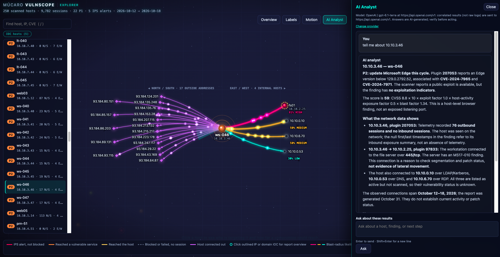

# Screenshot gallery

Examples of the upload workflow, reports, and Explorer. Click a preview to open the full-size image. These captures span several versions; older Explorer images show earlier branding and controls, including the removed Tour/Fly-Through button and an older host-summary layout.

## Explorer and AI Analyst

### AI Analyst drawer

The focused host graph sits beside an AI Analyst answer about the workstation's findings and observed connections.

### Earlier Explorer captures

A smaller sample network grouped by subnet, with a prioritized host list and connections across the graph.

A focused web server: outside addresses appear to the left, directly connected internal hosts to the right, and host details in the pane.

An application server with many internal connections; the pane lists peers and their investigation estimates.

A larger sample network overview with host clusters, many observed connections, and a prioritized host list.

A DMZ host with an inbound alert, a directly connected internal host, and possible onward paths shown for investigation.

## Upload workflow and reports

The upload page's local folder picker, used to select telemetry and scan files for analysis.

The dark executive summary with key numbers, top risks, an activity diagram, and recommended actions.

A light-theme close-up of the executive report's key numbers, top risks, and activity diagram.

The dark technical report covering data quality, prioritized findings, and per-host evidence.
