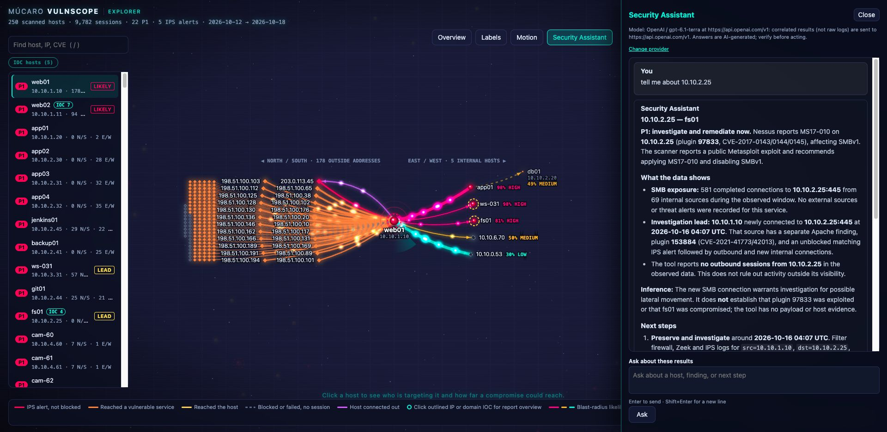
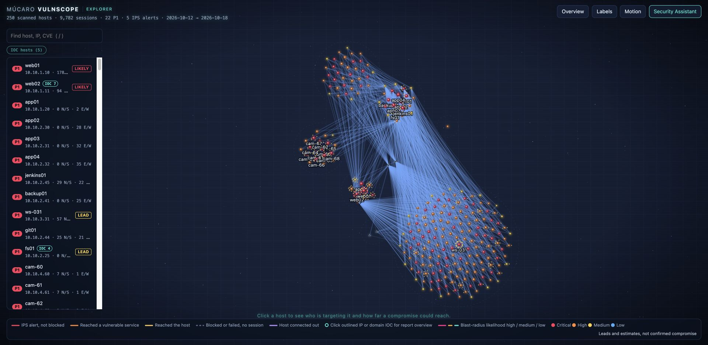
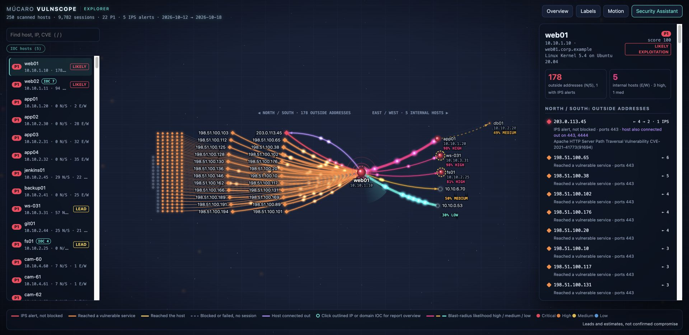
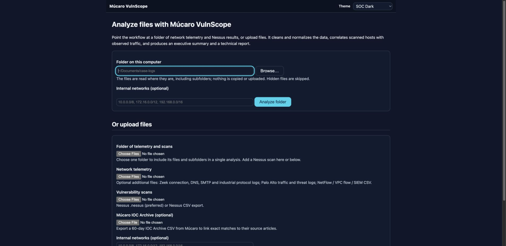
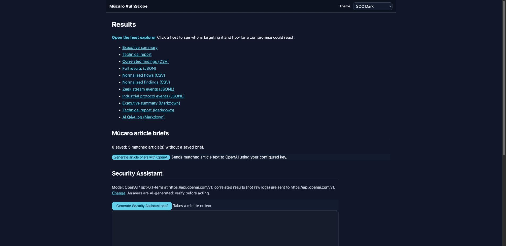

# Screenshot gallery

Examples of the upload workflow, reports, and Explorer. Click a preview to open the full-size image.

## Explorer and Security Assistant

### Security Assistant drawer

The focused host graph sits beside a Security Assistant answer about the findings and observed connections.

### Explorer overview

The sample network is grouped by subnet, with a prioritized host list and observed connections.

### Focused host

Outside addresses appear to the left, connected internal hosts to the right, and the host details in the pane.

## Upload workflow and reports

The upload page accepts a local folder or selected telemetry, scan, and Múcaro IOC Archive files.

The results page links to the reports and Explorer and offers Security Assistant controls.

The dark executive summary with key numbers, top risks, an activity diagram, and recommended actions.

A light-theme close-up of the executive report's key numbers, top risks, and activity diagram.

The dark technical report covering data quality, prioritized findings, and per-host evidence.
